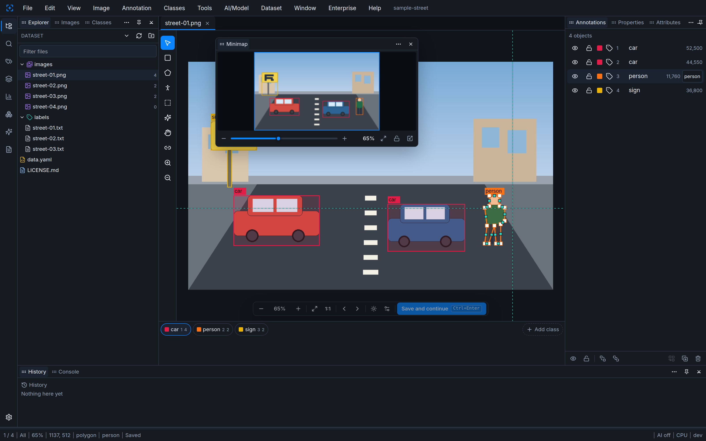
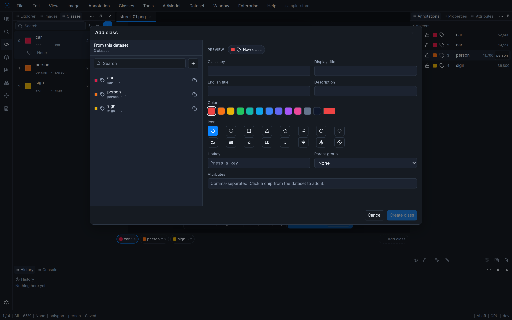
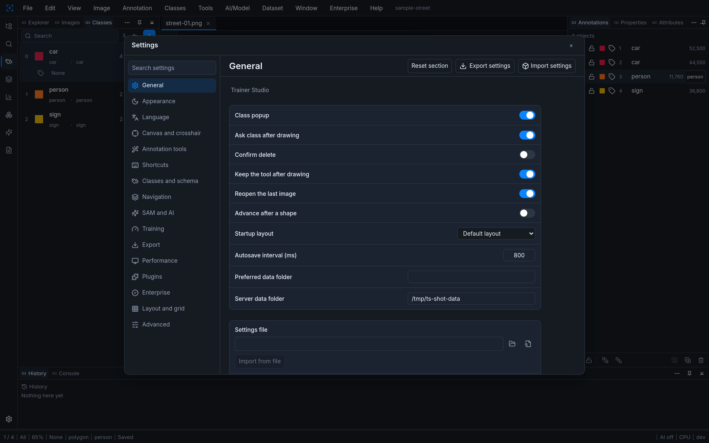
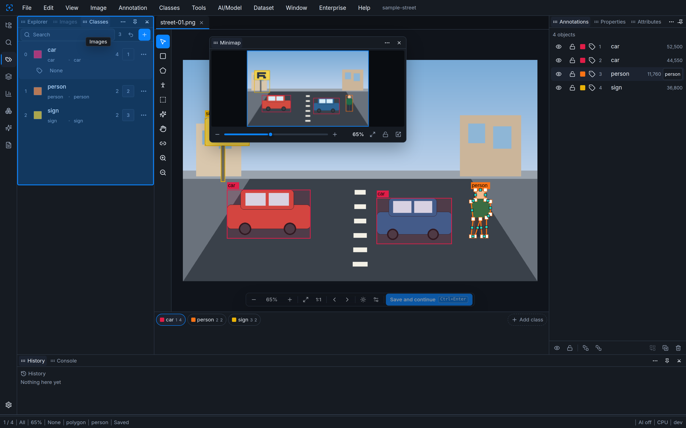
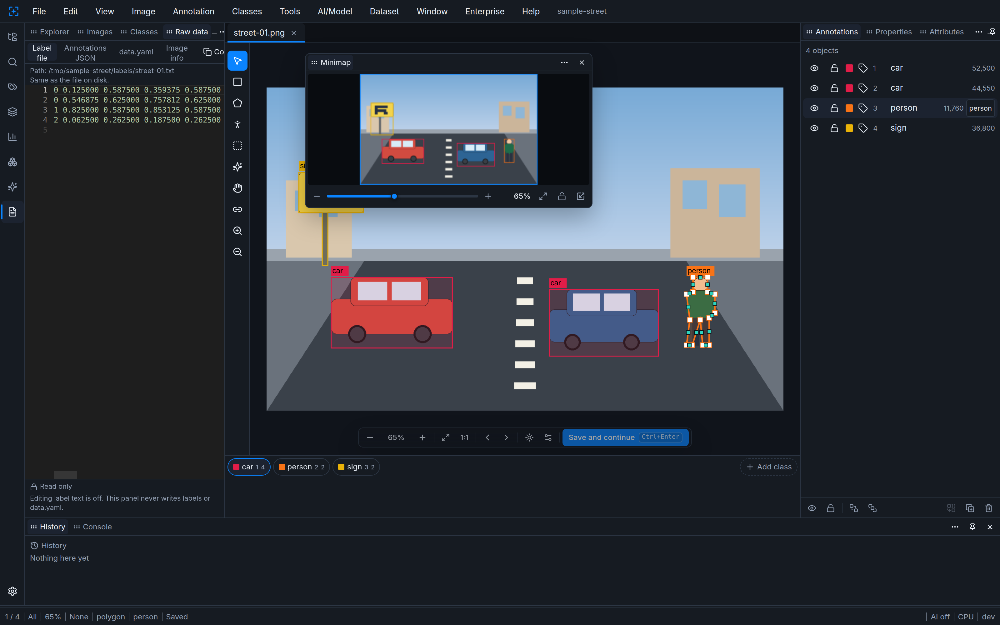
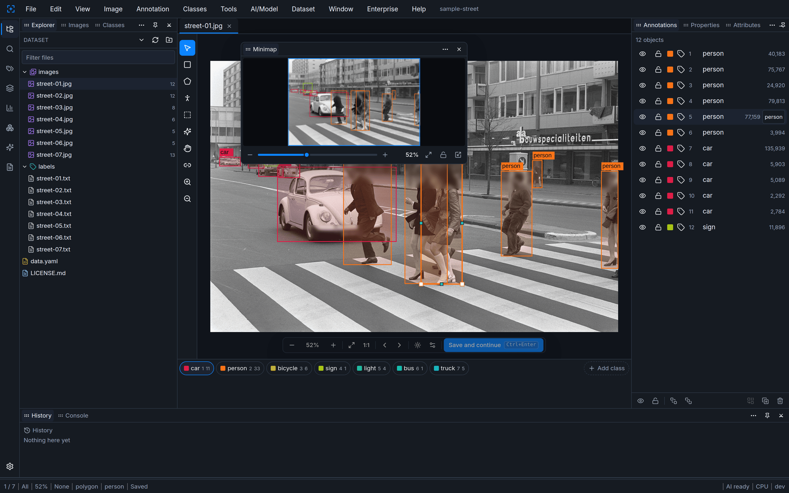
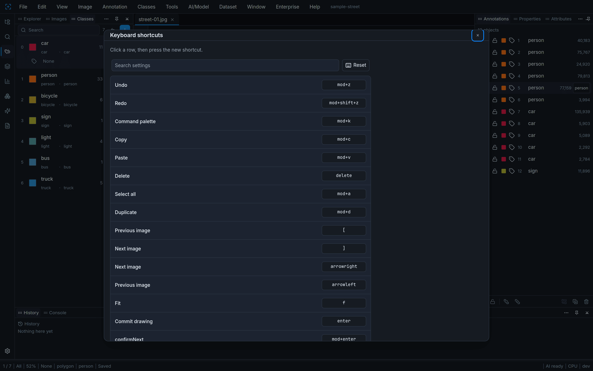

# Trainer Studio — Open-Source YOLO Annotation & Dataset Labeling Tool

[](LICENSE)
[](pyproject.toml)
[](web/package.json)
[](https://github.com/ondery/TrainerStudio)

Trainer Studio is a local-first, open-source image annotation tool for people who build YOLO object-detection datasets. You label bounding boxes and polygons in a browser, on a server that runs only on your computer, and the files stay in the Ultralytics YOLO layout (`data.yaml`, `images/`, `labels/`). The workspace is a dockable panel layout in the style of VS Code. The interface ships in 12 languages and defaults to English. The open core is AGPL-3.0. There is no account and no telemetry. Version 1.0.0.

> [!NOTE]
> Version 1.0.0. Video, team accounts, and the multi-job GPU queue stay in the commercial add-on. They are locked in this public tree.


## Contents

- [Key facts](#key-facts)
- [Features](#features)
- [Screenshots](#screenshots)
- [Quick start](#quick-start)
- [Keyboard shortcuts](#keyboard-shortcuts)
- [Languages](#languages)
- [Architecture](#architecture)
- [Project layout](#project-layout)
- [Comparison](#comparison)
- [What 1.0 includes](#what-10-includes)
- [FAQ](#faq)
- [Open core and Enterprise](#open-core-and-enterprise)
- [How to cite](#how-to-cite)
- [Contributing](#contributing)
- [License](#license)

## Key facts

- **Status:** 1.0.0. Video, team accounts, and the multi-job GPU queue stay in the commercial add-on
- **What it is:** an offline YOLO labeling tool and image annotation tool for object-detection datasets
- **License:** GNU Affero General Public License v3.0 (AGPL-3.0). See [LICENSE](LICENSE)
- **Platforms:** Windows, macOS, and Linux
- **Stack:** Next.js static UI, FastAPI, SQLite
- **Formats:** YOLO detect, segment, oriented boxes (OBB), and pose (`data.yaml` plus label text). Export can also write COCO JSON, Pascal VOC XML, CreateML, CVAT, LabelMe, KITTI, Darknet, Open Images CSV, and task JSON
- **Tools:** bounding boxes, polygons, vertex handles, guide lines, class hotkeys, save and next
- **Languages:** 12. A fresh install uses English until you choose another language
- **Offline:** yes. Labeling does not need a network, an account, or a GPU
- **Data:** images and labels stay in a folder you choose. The app database stays in the local data directory

## Features

### Labeling

- Bounding boxes and polygons, plus oriented boxes and pose when the dataset uses those YOLO tasks
- Selection handles for moving, resizing, and editing vertices. Guide lines and an optional crosshair follow the pointer
- Class hotkeys (`1`–`9`, then `Q`–`P`) and a class bar. Next class changes only the class used for the next shape
- Ctrl+Enter saves the image and opens the next one. It does not replace a shape's class on its own
- Suggestions from auto-label or SAM keep the class that was proposed, when those optional tools are installed and return a proposal. Accept or reject them without a silent class change
- Point prompts need the optional SAM packages and a weight file on disk. Labeling still works if they are not installed. The SAM bar downloads the selected weight file when you ask. A missing file returns `sam.weights` and does not download on its own

### Workspace

- VS Code-style dockable panels. A tab click activates the tab. Dragging starts only after the pointer moves, and the drop target is one soft highlight
- Project explorer for the dataset tree, an image list, and the class table
- Navigator (minimap) with the current view, and a filmstrip
- Raw data panel: the label file in a Monaco editor, plus JSON, `data.yaml`, and image facts
- Ctrl+K opens the shared command list: classes, languages, and the same commands the menus run. A plugin can add a command to that list. Ctrl+P is quick open. Escape closes only the top menu, popover, or dialog

### Data

- Open a folder that already has `data.yaml`, `images/`, and `labels/`
- Class ids and their order come from `data.yaml` and are not renumbered on open
- Class names, colors, and hotkeys are edited in the class manager. Removing or merging classes asks for confirmation
- Import is the YOLO text you already have. Export writes a copy as YOLO, COCO, Pascal VOC, CreateML, CVAT, LabelMe, KITTI, Darknet, or Open Images and does not overwrite the source dataset. A plugin can add another folder format
- Task JSON is a separate exchange. File → Import tasks reads a task list, and File → Export → Task JSON writes one. Coordinates in that file are percentages of the image. Rectangles, polygons, rotated rectangles, and keypoints become the shapes this app edits. Brush, ellipse, and open vector regions keep their original values until you edit them, then they export as polygons. Predictions stay in review and are not written to `labels/` until you accept them. A remote address is not downloaded. A class name that is not in `data.yaml` is skipped unless you choose to add the missing classes
- A small CC0 photograph sample lives in [`samples/street`](samples/street/LICENSE.md). Class names in that sample are car, person, bicycle, sign, light, bus, and truck

### Training

A local training job and auto-label are in the open core. They stay idle until you install the optional packages and, for SAM or a training run, the weights those packages expect. `plugins/example` adds one command. `plugins/boxfile` is an engine you can drop in. It does not relabel a dataset until you run its job.

- When Ultralytics is installed, a job can use the YOLO11, YOLOv8, and YOLO26 model names listed in the app, or weights you supply. Ultralytics is AGPL-3.0. The open core runs one CUDA job at a time
- An optional RT-DETR backend uses Hugging Face Transformers (Apache-2.0) and does not import Ultralytics. Install it from `requirements-rtdetr.txt`. It can detect and fine-tune when Transformers is installed. Predictions whose names are not in `data.yaml` are skipped
- A multi-job GPU queue stays in the commercial add-on
- CPU is enough for labeling. A GPU is optional and is used only when the installed PyTorch build can see CUDA

## Screenshots

The pictures below use the default dark theme and the CC0 photographs in `samples/street`. They are not a private dataset.

|                                                                                                                                                                                |                                                                                              |
| ------------------------------------------------------------------------------------------------------------------------------------------------------------------------------ | -------------------------------------------------------------------------------------------- |
|  | Main workbench. Class bar along the bottom, explorer on the left, navigator over the canvas. |
|                                                                         | Selection handles and guide lines.                                                           |
|                                                                                                   | Class manager and the new-class dialog.                                                      |
|                                                                                                            | Settings. Language, guides, and the locked commercial section.                               |
|                                                                                           | Docking. One highlight follows the pointer. No drop grid.                                    |
|                                                                               | Raw data panel.                                                                              |
|                                                                             | Project explorer and the dataset tree.                                                       |
|                                                                                                                       | Keyboard shortcuts.                                                                          |

## Quick start

You need Python 3.11 or newer. The app listens on `http://127.0.0.1:43150` and opens a browser window. Set `STUDIO_PORT` if that port is already in use, and `STUDIO_DATA_DIR` to choose the folder for the app database.

A sample dataset you can open is included at `samples/street`.

### Windows

From this folder:

```bat
py -3 -m venv .venv
.venv\Scripts\python -m pip install -r requirements.txt
.venv\Scripts\python -m trainer_studio
```

`start-trainer-studio.bat` creates the virtual environment if needed, runs the same install check, and starts the app.

### macOS and Linux

```bash
python3 -m venv .venv
source .venv/bin/activate
python -m pip install -r requirements.txt
python -m trainer_studio
```

### Docker

The published image is the open core. It listens on port 43150. Mount the dataset folder at `/data`. The app database stays in the container volume, not in the dataset.

```bash
docker run --rm -p 43150:43150 -v /path/to/dataset:/data ghcr.io/ondery/trainerstudio:1.0.0
```

Then open `http://127.0.0.1:43150`. On Windows, use a drive path such as `C:\labels\dataset` after the `-v`.

### Optional AI packages

SAM, auto-label, and local training need extra packages. If you already have a CUDA build of PyTorch, install that first so pip does not replace it.

```bash
python -m pip install -r requirements-ai.txt
```

RT-DETR training and detection use a second file. Install CUDA PyTorch first when you already have it.

```bash
python -m pip install -r requirements-rtdetr.txt
```

## Keyboard shortcuts

On macOS, the Ctrl shortcuts below that are chords (Ctrl+Enter, Ctrl+K, and the rest of the `mod` bindings) use Command instead of Ctrl. Letter tools such as `V` and `B` stay the same. The list matches the bindings in the open core.

| Shortcut                          | Action                                                        |
| --------------------------------- | ------------------------------------------------------------- |
| `1`–`9`, `Q`–`P`                  | Choose a class                                                |
| `V` `B` `G` `O` `P` `M` `H`       | Select, box, polygon, oriented box, pose, SAM, pan            |
| `C`                               | Copy annotations from the previous image                      |
| Shift+`C`                         | Track toward the next frame                                   |
| Ctrl+Enter                        | Save and open the next image                                  |
| Shift+Enter                       | Next unlabeled image                                          |
| Enter                             | Confirm a polygon or a SAM prompt                             |
| Backspace                         | Remove the last draft point, or delete                        |
| Escape                            | Cancel the draft                                              |
| Delete                            | Delete the selection                                          |
| Tab / Shift+Tab                   | Cycle the selection                                           |
| `A` / `X`                         | Accept or reject a suggestion                                 |
| Alt+Backspace                     | Reject a pending box                                          |
| Ctrl+Shift+Enter                  | Accept a pending box without stepping                         |
| Ctrl+Z / Ctrl+Shift+Z / Ctrl+Y    | Undo / redo                                                   |
| Ctrl+A / Ctrl+D                   | Select all / duplicate                                        |
| `[` / `]`                         | Previous / next image                                         |
| Arrow keys                        | Nudge the selection, or change image when nothing is selected |
| `F`                               | Fit the image                                                 |
| Ctrl+`0` or Ctrl+`1`              | Zoom to 100%                                                  |
| Ctrl+`=` / Ctrl+`-`               | Zoom in / out                                                 |
| Ctrl+`2`                          | Zoom to 200%                                                  |
| Shift+`2`                         | Zoom to the selection                                         |
| Space, or the middle mouse button | Pan                                                           |
| Shift+click / Ctrl+click          | Add to the selection / toggle a shape                         |
| Alt+drag                          | Copy the shape                                                |
| Alt+click a vertex                | Delete that vertex when the polygon has more than three       |
| Ctrl+`;`                          | Guide lines                                                   |
| Ctrl+Shift+`;`                    | Crosshair cursor                                              |
| `\`                               | Skip this image                                               |
| F1                                | Shortcut help                                                 |
| F2                                | Rename the file selected in the explorer                      |
| F7 / F8 / Ctrl+Shift+G            | Layers, navigator, filmstrip                                  |
| Ctrl+Shift+F                      | Float the layers panel                                        |
| Ctrl+Shift+V                      | Paste the selection onto the next image                       |
| Ctrl+B                            | Collapse the side bar                                         |
| Ctrl+K                            | Command palette                                               |
| Ctrl+P                            | Quick open                                                    |
| Ctrl+E                            | Export                                                        |
| Ctrl+`,`                          | Settings                                                      |
| Ctrl+`/`                          | This shortcut list                                            |
| Ctrl+H                            | History                                                       |
| Ctrl+Q                            | Quality check                                                 |
| Alt+`1`–Alt+`8`                   | Vehicle attributes on speed classes                           |

## Languages

English, Turkish, German, Spanish, French, Italian, Brazilian Portuguese, Russian, Arabic, Japanese, Korean, and Simplified Chinese.

Codes: `en`, `tr`, `de`, `es`, `fr`, `it`, `pt-BR`, `ru`, `ar`, `ja`, `ko`, `zh-CN`.

A new browser profile with no saved language opens in English. A language you already chose stays in effect. Arabic uses a right-to-left layout.

## Architecture

The interface is a Next.js app built as a static export and served by FastAPI from the `static/` directory. API routes are registered first, then the files. Project state, classes, and annotations are stored in a SQLite database in the data directory (`STUDIO_DATA_DIR`, or `STUDIO_DATA`, or `data/` beside the app).

The process binds to `127.0.0.1` unless `STUDIO_HOST` is set. There is no account and no telemetry.

The page can be installed from the browser. The installed icon opens this address. It does not start the Python process. The service worker does not cache `/api/`.

Local file routes require a session token. `GET /api/health` returns that token, and the page sends it back as the `X-Studio-Session` header on dialog, local-file, and filesystem routes. A page on another origin cannot read the token. A path outside the data directory is allowed only with a one-time grant issued by the folder dialog for that exact path. Anything else returns HTTP 403. The generic file writer will not write into an opened dataset's `labels/` tree or its `data.yaml`. Annotation saves go through the project API, which reads class indexes from `data.yaml` at write time and does not store a client-supplied class number.

## Project layout

```
trainer_studio/     FastAPI app, YOLO import and export, SQLite
web/                Next.js interface (source)
static/             Built interface served by the API
plugins/            Example command and the boxfile engine
src-tauri/          Windows, macOS, and Linux installer source
samples/street/     CC0 photographs used in the screenshots
docs/screenshots/   Interface pictures
docs/FAQ.md         Questions and answers
tests/              Pytest suite for the open core
```

A dataset folder looks like this:

```
your-dataset/
  data.yaml
  images/
  labels/
```

`names` in `data.yaml` is the class list. Index 0 is the first name. Opening the folder does not reorder those names and does not rewrite label files.

The app database is not stored inside the dataset. It lives in the data directory.

## Comparison

Figures below describe the public open core of Trainer Studio and the usual public offering of each other tool. Hosted products change, so the commercial column is only a pointer, not a review.

|                             | Trainer Studio                                         | LabelImg                                         | CVAT                                          | Open labeling server                                            | Roboflow Annotate                               |
| --------------------------- | ------------------------------------------------------ | ------------------------------------------------ | --------------------------------------------- | --------------------------------------------------------------- | ----------------------------------------------- |
| License of the tool you run | AGPL-3.0                                               | MIT                                              | MIT                                           | Apache-2.0 for the open-source server                           | Commercial hosted product                       |
| Where it runs               | Local Python process and a browser on the same machine | Desktop application                              | Self-hosted server, or CVAT's hosted service  | Self-hosted server, or a cloud account                          | Cloud                                           |
| Account required to label   | No                                                     | No                                               | No on a server you run yourself               | No on a server you run yourself                                 | Yes                                             |
| Offline labeling            | Yes, after the Python packages are installed           | Yes                                              | Yes on a private server you already installed | Yes on a private server you already installed                   | The hosted annotator needs a network connection |
| Bounding boxes              | Yes                                                    | Yes                                              | Yes                                           | Yes                                                             | Yes                                             |
| Polygons                    | Yes                                                    | The project draws rectangles                     | Yes                                           | Yes                                                             | Yes                                             |
| YOLO files                  | Detect, segment, OBB, and pose text, plus `data.yaml`  | Detection text, and also Pascal VOC and CreateML | YOLO is one of the export formats             | YOLO is one of the documented export formats, with COCO and VOC | YOLO export from the hosted project             |
| Extra setup                 | A virtual environment and `pip install`                | A Python/Qt install                              | A server install, often with Docker           | A server install, or a cloud signup                             | An account on the hosted platform               |

## What 1.0 includes

Version 1.0.0 closes the 0.6.4.3 preview list. The commercial rows stay out of this public tree. A license key in the add-on unlocks them. Without that key the routes return HTTP 402.

| Item                                                    | Status                                                                                                                                                                                                                                      |
| ------------------------------------------------------- | ------------------------------------------------------------------------------------------------------------------------------------------------------------------------------------------------------------------------------------------- |
| Command list                                            | Shipped. Menus and Ctrl+K share one registry. A plugin command is a palette row and runs its route.                                                                                                                                         |
| Keybinding service                                      | Shipped. Bindings have when-clauses. The editor refuses a combo that can fire two actions at once.                                                                                                                                          |
| One overlay stack for menus, popovers, and dialogs      | Shipped. Escape closes only the top layer.                                                                                                                                                                                                  |
| Layout audit across window sizes and languages          | Shipped. `scripts/layout-audit.spec.mjs` covers 1280, 1366, 1920, 2560, and 3354 for English, Turkish, German, Japanese, and Arabic.                                                                                                        |
| Installable PWA                                         | Shipped. The manifest and service worker install the page. The icon does not start the Python process.                                                                                                                                      |
| Training and auto-label                                 | Shipped in the core as one local job, including an engine plugin slot. `plugins/boxfile` is the drop-in example. A multi-job GPU queue stays in the commercial add-on.                                                                      |
| SAM point prompts                                       | Shipped when the optional packages are installed and a weight file is on disk. The SAM bar can download that file. Missing weights return `sam.weights` and do not download on their own.                                                  |
| Export formats                                          | Shipped. YOLO, COCO JSON, Pascal VOC XML, CreateML, CVAT XML, LabelMe, KITTI, Darknet, and Open Images CSV. A plugin exporter can add another.                                                                                            |
| Video and camera import                                 | Shipped in the commercial add-on. This public tree keeps the routes locked.                                                                                                                                                                 |
| Team accounts, roles, review assignment                 | Shipped in the commercial add-on. This public tree keeps the routes locked.                                                                                                                                                                 |
| macOS and Linux installers                              | Shipped as release jobs. A `v*` tag builds an unsigned macOS app and dmg, and a Linux deb and AppImage.                                                                                                                                     |
| Tagged 1.0 release and a Windows installer in this tree | Shipped. `src-tauri/` is in this tree. A `v*` tag builds the MSI and NSIS installers.                                                                                                                                                       |

## FAQ

### Is this a finished 1.0?

Yes. Version 1.0.0 is the tagged open-core release. [What 1.0 includes](#what-10-includes) records what shipped, and which rows stay in the commercial add-on.

### Is Trainer Studio free?

The open core in this repository is free to run under AGPL-3.0. If you offer the software as a network service, the AGPL requires you to offer the corresponding source to users of that service. A separate commercial add-on is not in this repository. This page does not list prices. Contact the author for that add-on.

### Does it work offline?

Yes. After installation, labeling, saving, and YOLO export do not call an external service. There is no sign-in. Optional model downloads for SAM or training are the part that needs a network, and only when you choose to fetch weights.

### Which formats can it read and write?

It opens Ultralytics YOLO datasets: `data.yaml` with detect, segment, oriented-box, or pose label text. Export writes a new folder as YOLO, COCO JSON, Pascal VOC XML, CreateML, CVAT, LabelMe, KITTI, Darknet, or Open Images. The source dataset is left as it is.

### How do I export to YOLO?

Save while you label. Each save writes the current image's `.txt` file under `labels/` using the class indexes in `data.yaml`. To make a separate copy, use Export (Ctrl+E) and choose the YOLO format and a destination folder. That copy can group images by train, val, and test. It does not modify the folder you have open.

### How is it different from LabelImg?

LabelImg is a desktop bounding-box annotator with YOLO detection text. Trainer Studio is a local browser workspace for boxes and polygons, with dockable panels, a class manager, 12 languages, and YOLO detect, segment, OBB, and pose. Both can run offline on one computer. Trainer Studio is AGPL-3.0. LabelImg is MIT.

### Does it need a GPU?

No. Drawing, saving, and export use the CPU. SAM and training can use a GPU when your PyTorch install sees CUDA, and they also run on CPU. A queue of GPU jobs is part of the commercial add-on, not the open core.

### Which operating systems are supported?

Windows, macOS, and Linux, with Python 3.11 or newer. The interface is tested as a static site served by the local API. Node.js 22 is needed only if you rebuild the web interface from `web/`.

### Can a team use it?

The open core is a single-user app on one machine. Roles, single sign-on, review assignment, and a shared job queue are available in the commercial add-on. Contact the author. They are not included here and they stay locked.

### Where is my data stored?

Images and label files stay in the dataset folder you opened. The SQLite database, thumbnails, and logs stay in the data directory on the same computer. Nothing in the open core uploads that folder.

### What if the page cannot open a folder?

The API must be the one that served the page, because the page has to send the session header. Start Trainer Studio and use the browser tab it opened. A path outside the data directory has to be chosen in the folder dialog so the app can grant that path. Writes into another location return HTTP 403.

More answers are in [docs/FAQ.md](docs/FAQ.md).

## Open core and Enterprise

This repository is the open core: labeling, classes, import and export, the dockable workspace, the command registry, and local SAM and training when the optional packages are installed. `plugins/example` and `plugins/boxfile` ship with the tree. They do not relabel a dataset on their own.

The following are available in the commercial add-on. Contact the author. They are not shipped here, and the interface keeps them locked:

- Accounts, roles, and single sign-on
- An audit log and review assignment
- Postgres or S3 storage
- A GPU job queue, active learning, and analytics
- Priority support
- Video frame import and remote video
- Installing marketplace plugins, extra folders, and pop-out windows

No prices are listed in this repository.

## How to cite

Metadata for software citation is in [CITATION.cff](CITATION.cff).

BibTeX:

```bibtex
@software{trainerstudio,
  title = {Trainer Studio},
  author = {{ondery}},
  version = {1.0.0},
  year = {2026},
  url = {https://github.com/ondery/TrainerStudio},
  license = {AGPL-3.0}
}
```

Plain text:

> ondery. (2026). Trainer Studio (1.0.0) [Computer software]. https://github.com/ondery/TrainerStudio

## Contributing

Issues and pull requests are welcome. See [CONTRIBUTING.md](CONTRIBUTING.md). Please do not attach private datasets, license keys, or customer data.

Security reports go through [GitHub security advisories](https://github.com/ondery/TrainerStudio/security/advisories/new), not a public issue. See [SECURITY.md](SECURITY.md).

## License

The open core is licensed under the GNU Affero General Public License v3.0. See [LICENSE](LICENSE) and [LICENSING.md](LICENSING.md).

The photographs in `samples/street` are CC0 1.0 works from Wikimedia Commons. See [samples/street/LICENSE.md](samples/street/LICENSE.md).
