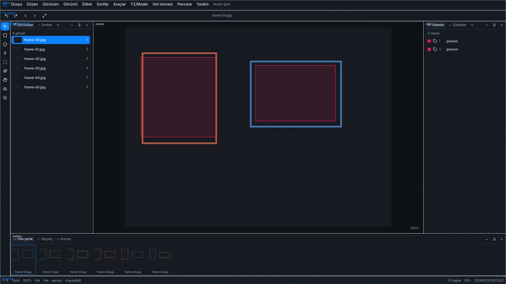

# Layout grid

Trainer Studio is laid out on a CSS grid. The shell and the workspace are separate templates. Both are stored with the layout under `trainer-studio.layout` and can be edited from Settings → Layout or by importing that JSON. The spacing base is 8px. Track sizes, gaps, and floating windows snap to that module.

## Shell

The application shell is one grid. Its areas are named `menu`, `toolbar`, `palette`, `workspace`, and `status`. `grid-template-areas` and the column and row tracks come from the active breakpoint. Resizing the window selects the template. The four breakpoints are 1366, 1920, 2560, and 3354.

| Width | Areas | What changes |
| --- | --- | --- |
| 1366 | menu, palette, workspace, status | The toolbar shares the menu row. The menu row is at least 72px. |
| 1920 | menu, toolbar, palette, workspace, status | The toolbar is its own row. Palette track is 40px. |
| 2560 | the same names, three columns | Palette track is 48px. The workspace spans two columns. |
| 3354 | the same names, four columns | Menu, toolbar, and status tracks grow by 8px. The workspace spans three columns. |

`menu` holds the menu bar. `toolbar` holds the options bar. `palette` holds the tool buttons. `workspace` holds the dock. `status` holds the status bar. A lock notice sits in the toolbar row, or in the menu row when the breakpoint has no toolbar area.

## Workspace

Inside `workspace`, a second grid has 12 equal columns and 12 equal rows. Docked zones occupy rectangular areas:

- `left` is the start edge. In Arabic it is placed on the right.
- `canvas` is the remaining cells beside the side zones.
- `right` is the end edge.
- `bottom` is a full-width band under the canvas.

A zone’s span is how many tracks it occupies. Dragging its edge changes that span for the current breakpoint and writes it back into `layout.spans`. An empty zone uses no tracks, so the canvas grows into them. A collapsed zone keeps a single track for its tab strip.

Floating panels are items on this same 12 by 12 grid. Their `col`, `row`, `colSpan`, and `rowSpan` are the position and size. Dragging snaps to the nearest track. The stored `x`, `y`, `w`, and `h` values are the same rectangle measured in 8px modules.

Named presets are Default, Labeling, Review, and Training. Each preset stores the shell templates, the track sizes (`palette`, `menu`, `toolbar`, `status`), the spans for every breakpoint, and which panels sit in which zone. Save writes the current definition. Reset restores Default.

## Forms

Settings, property editors, class rows, the options bar, and dialog bodies use the shared 12-column grid (`Grid` and `GridItem`). A label takes 4 columns and its control takes 8. The gap is 8px, so controls line up across those surfaces.

## Layout guide

View → Show layout grid draws a dashed outline on each shell area and on each workspace zone. It is off by default and does not follow the pointer. It is not drawn while a panel is dragged. The control is `showGrid` in `trainer-studio.appearance`.

